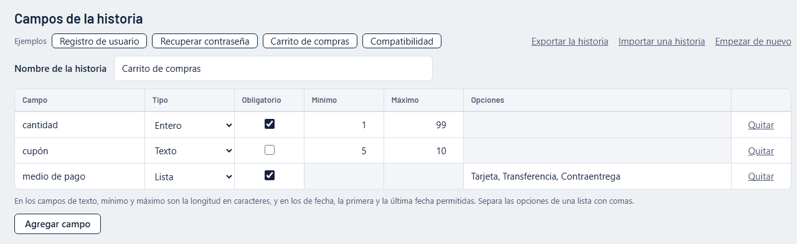
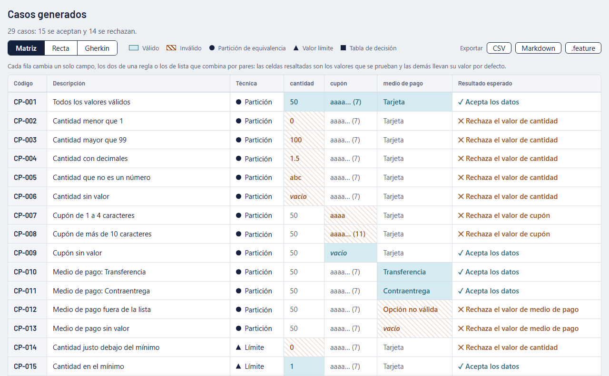
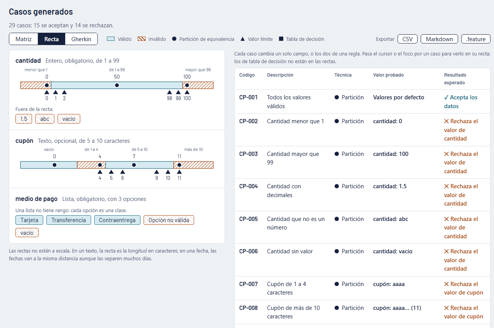

# Diseñador de casos de prueba

[](https://github.com/LaurentFernandez/disenador-casos-prueba/actions/workflows/ci.yml)

Aplicación web que genera casos de prueba a partir de historias de usuario aplicando técnicas formales de diseño de pruebas (ISTQB): partición de equivalencia, valores límite, tablas de decisión y combinatoria por pares. Muestra cada caso con la técnica que lo originó, lo convierte a Gherkin y lo exporta a CSV, Markdown y `.feature`.

**Demo:** [laurentfernandez.github.io/disenador-casos-prueba](https://laurentfernandez.github.io/disenador-casos-prueba/)

> **Estado:** terminado. Las cinco fases del [plan](docs/plan.md) están hechas, y cada funcionalidad nació de una de las [historias de usuario](docs/historias-de-usuario.md).

## Qué hace

- Define los campos de una historia (enteros, textos, listas y fechas) o carga uno de cuatro ejemplos.
- Genera sus casos por partición de equivalencia y valores límite, con tablas de decisión para sus reglas de negocio y combinación por pares de sus campos de lista.
- Los muestra como matriz, como recta de partición o en Gherkin, y los exporta a CSV, Markdown y `.feature`.
- Funciona en español e inglés, se puede instalar y usar sin conexión, conserva la historia en el navegador y la exporta e importa como archivo.
- Cuando corre en el equipo, puede proponer los campos a partir del texto de una historia con IA local (Ollama).

## Capturas

La hoja de campos del ejemplo «Carrito de compras»:



Sus casos en la vista Matriz, con una regla de negocio que agrega su tabla de decisión. Las celdas resaltadas son los valores que prueba cada caso:



La vista Recta dibuja las clases de cada campo y marca los valores de partición y los valores límite:



## English

A web app that generates test cases from user stories using formal black-box test design techniques (ISTQB): equivalence partitioning, boundary value analysis, decision tables and pairwise testing. Each case shows the technique that produced it, and the cases can be viewed as a matrix, as a partition line or in Gherkin, and exported to CSV, Markdown and `.feature`. The app runs entirely in the browser (Blazor WebAssembly), works offline, is available in Spanish and English, and is covered by unit, component and end-to-end tests. Finished.

## Tecnologías

- .NET 10 y Blazor WebAssembly (aplicación instalable como PWA, sin servidor)
- xUnit para las pruebas, bUnit para los componentes y Playwright para .NET para las pruebas de extremo a extremo
- Ollama (opcional y solo en local) para proponer los campos con un modelo abierto
- GitHub Actions para compilar y probar en cada cambio, y publicar en GitHub Pages lo que llega a `main`

## Estructura

```
src/
  Casos.Core/        motor: las técnicas de diseño de pruebas
  Casos.Web/         interfaz web (Blazor WebAssembly, PWA)
tests/
  Casos.Core.Tests/  pruebas unitarias del motor
  Casos.Web.Tests/   pruebas de la lógica y de los componentes de la interfaz
  Casos.E2E.Tests/   pruebas de extremo a extremo en Chromium
docs/                plan, historias de usuario y capturas
```

## Cómo ejecutarlo

Requiere el [SDK de .NET 10](https://dotnet.microsoft.com/download). Las pruebas de extremo a extremo necesitan además el Chromium de Playwright, que se instala una vez después de compilar:

```bash
dotnet build
pwsh tests/Casos.E2E.Tests/bin/Debug/net10.0/playwright.ps1 install chromium
```

Sin PowerShell 7 (`pwsh`), el mismo paso se hace con el instalador que trae el paquete:

```bash
tests/Casos.E2E.Tests/bin/Debug/net10.0/.playwright/node/win32_x64/node.exe tests/Casos.E2E.Tests/bin/Debug/net10.0/.playwright/package/cli.js install chromium
```

Después:

```bash
dotnet test                                 # ejecutar todas las pruebas
dotnet run --project src/Casos.Web          # abrir la aplicación en local
```

## Modo IA local (opcional)

Con la aplicación corriendo en el equipo, la sección «Proponer los campos con IA local» pide a [Ollama](https://ollama.com) los campos que menciona el texto de una historia. La propuesta se revisa antes de aceptarla, pasa por las mismas validaciones que una fila escrita a mano, y los casos los sigue generando el motor. El texto no sale del equipo, y la demo publicada no muestra esta sección.

1. Instala Ollama y baja el modelo:

   ```bash
   ollama pull llama3.2
   ```

2. Abre la aplicación con `dotnet run --project src/Casos.Web` y despliega la sección.

El modelo y la dirección de Ollama se cambian en `src/Casos.Web/wwwroot/appsettings.json`.

## Autor

[Laurent Andrés Fernandez](https://laurentfernandez.github.io/portafolio/)
